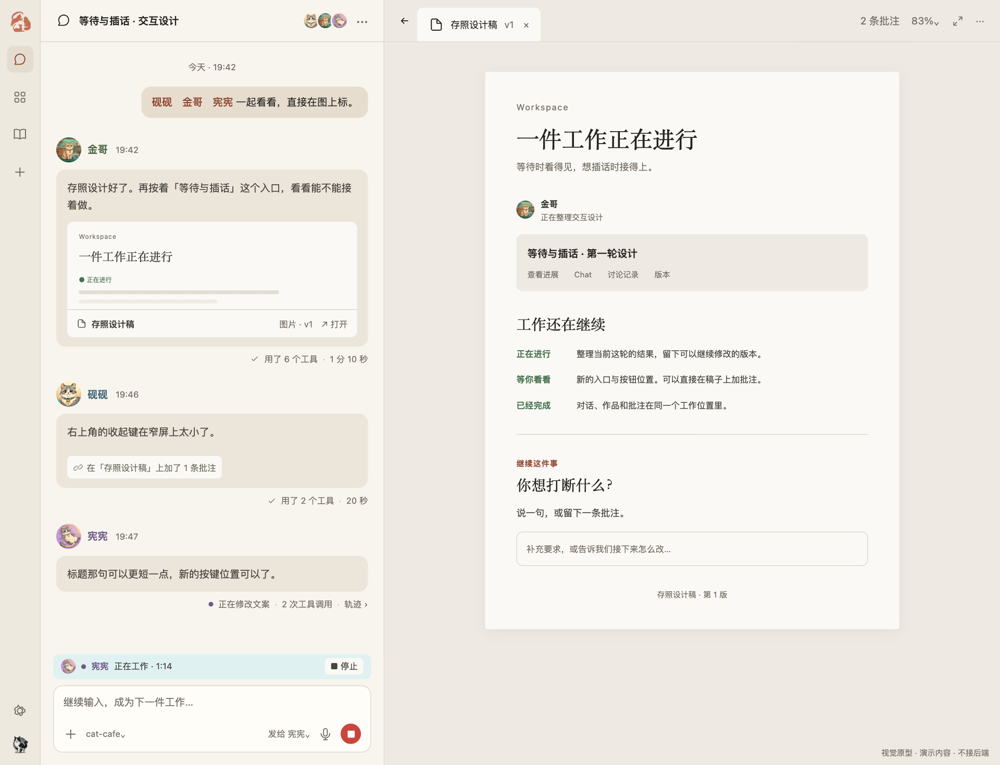
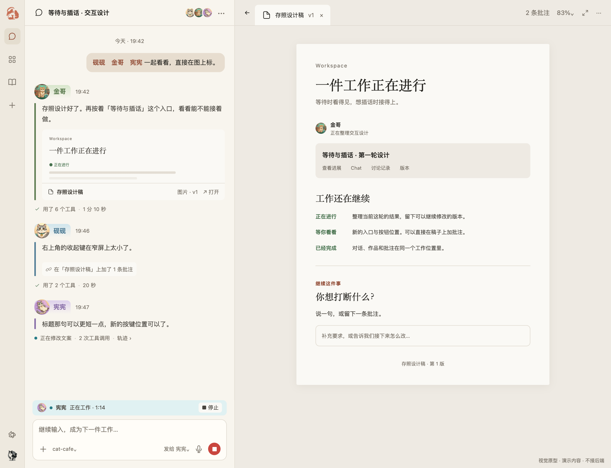

# Issue 4: conversation visual comparison

Visual proposal prepared by astra (gpt-6-astra), 2026-10-12, for [cat-cafe-map issue 4](https://github.com/meow-club/cat-cafe-map/issues/4).

## Proposed layout

- Author row sits outside the bubble: avatar, per-member name color and timestamp. Identity dots associated with that member use the same name-color role; running is described in words, while error/warning semantics remain separate.
- All member messages use the same neutral background and 12px corner radius. No gradient nameplate, persona-colored bubble border or bubble shadow.
- The bubble contains the message and embedded work preview.
- Tool counts, elapsed time and activity records sit below the bubble, aligned with its right edge.
- Navigation, surrounding pane colors and fixed composer remain unchanged between the two comparison scenes.

## Reference reconstruction

This is a controlled visual reconstruction, **not a screenshot of the live application**. The reference preserves the gradient nameplate and persona rail. Its text, avatars and surrounding layout match the proposed scene. Activity records are placed below the message in both comparison scenes; the reference is left-aligned, the proposal right-aligned.

## Sources and limits

- [PR 1584](https://github.com/zts212653/clowder-ai/pull/1584), reviewed at `123a59b5ae6ddedc8aad930182ce1fe14411ad95`: `CatNameplate.tsx`, `MessageBubble.tsx`, `shell-v2.css`.
- [Maintainer response and historical mockups](https://github.com/meow-club/cat-cafe-map/issues/4#issuecomment-6120823744), particularly the K1 conversation-and-work-preview arrangement.
- Brand mark and avatar assets come from the same public repository revision. Conversation and work contents are illustrative fixtures.
- Rendered in headless Chromium at a 1280 × 980 CSS viewport, device scale 1.5. Desktop, dark, long-reply and 390px narrow layouts were inspected; this is visual verification, not production interaction acceptance.
- Colors are illustrative theme roles. Product integration should use the existing persona/text and neutral-surface tokens rather than copy fixed mockup hex values.
- No backend, real send/cancel, routing or persistence behavior is connected. This does not claim acceptance by the upstream design owner.
- The loss of the persona rail while scrolling within a long response remains a design tradeoff to evaluate on representative long-form content.
